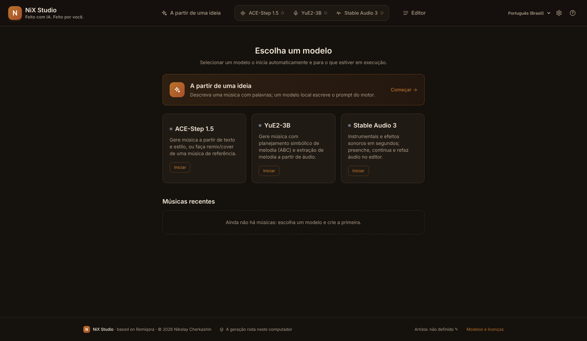

<h1 align="center">NiX Studio</h1>

An AI music studio that runs entirely on your computer. 
<a href="https://nix-studio.adalink.app">nix-studio.adalink.app</a>

Generate a song from a description or lyrics, split it into stems, rebuild parts with the AI arranger, mix in the
timeline editor and take the result to your own DAW. Nothing is sent to the cloud.

NiX Studio is a rebrand of [Remiqora](https://github.com/inikolax/remiqora) by Nikolay Cherkashin, used under the
[MIT licence](../LICENSE). It follows upstream closely: the code is upstream's, and only the name and the look differ.

## Documentation

Features, requirements and setup are upstream's and are described in the upstream guide, kept in this repository:
[README.md](../README.md) (English) · [README.ru.md](../README.ru.md) (Русский). Where that guide says "Remiqora",
read "NiX Studio"; its download links lead to upstream's unbranded installers, NiX Studio's are on
[nix-studio.adalink.app](https://nix-studio.adalink.app).

## How the rebrand works

Upstream's files are not edited. Everything that makes the app NiX Studio lives in [`brand/`](../brand) and is
applied when the app is built, so new upstream versions merge without conflicts. See
[brand/README.md](../brand/README.md).
